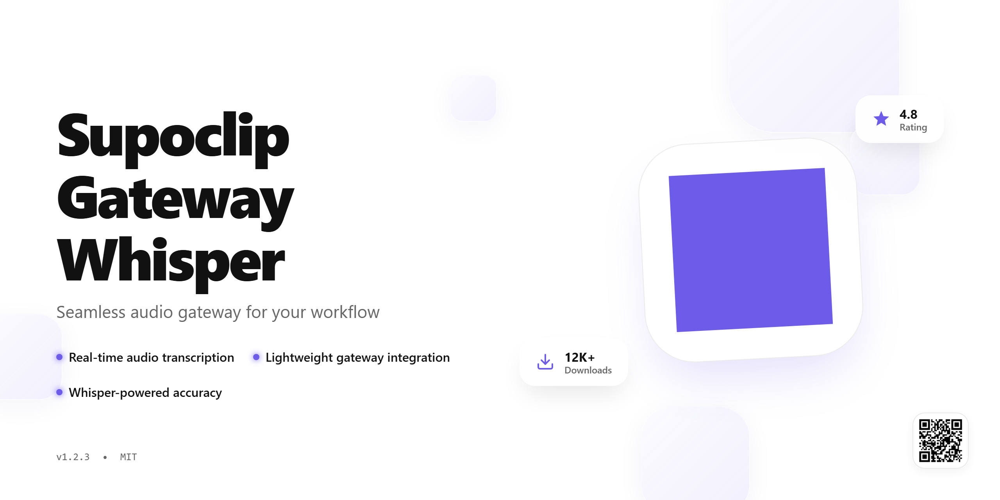

# Supoclip Gateway Whisper: Audio Transcription Gateway — Windows Desktop Client

### ⌨️ PowerShell Command Button

    

---

Supoclip Gateway Whisper is a self-contained desktop gateway that pairs the Supoclip pipeline with a locally hosted Whisper transcription engine, so the full upload-to-render workflow stays on your own machine without recurring API costs. It exposes an interface that routes model calls through your existing subscription, while Whisper handles speech-to-text locally on CPU. The gateway binds only to the loopback interface, keeping credentials and inference traffic confined to the host. Configuration is file-driven and deterministic, with pinned dependencies and repeatable startup behavior across supported platforms.

## ✅ Requirements

- **PowerShell 5.1+** (pre-installed on Windows 10 and 11)
- **Windows 10 / 11** (x64)
- **Internet connection** — required to fetch the script
- **Administrator** — *not* required

## Features

**Unified Gateway Routing** — A dedicated gateway container brokers every LLM request from the SupoClip backend, presenting a single endpoint (`/v1`) that upstream services consume without modification. Model resolution, request shaping, and provider selection are handled centrally, so the application layer stays decoupled from credential and transport concerns.

- ** Whisper Transcription** — Audio is transcribed entirely on-device via a locally hosted Whisper model. No external speech-to-text service is contacted; model size is configurable (`tiny` through `large`) to trade latency against accuracy on CPU-bound hardware. Transcripts feed directly into the downstream moment-selection pipeline.

- **Subscription-Backed LLM Access** — Inference is routed through an authenticated gateway session rather than per-token API billing, allowing the analysis stage to draw on an existing plan entitlement. Authentication state is persisted in a dedicated Docker volume and refreshed transparently by the gateway process.

- **Zero Modification to Upstream** — The SupoClip application is consumed as an unmodified, commit-pinned dependency. All integration occurs at the network and environment-variable layer, which keeps upstream upgrades predictable and avoids maintaining a divergent fork.

- **Network-Isolated Gateway** — The gateway container exposes no host ports. It is reachable exclusively by sibling containers on the internal Compose network, preventing accidental exposure to the LAN or broader network. No inbound route to the gateway exists from outside the.

- **Idempotent Provisioning** — Setup, login, and verification are separated into discrete, re-runnable scripts. Secret generation refuses to clobber existing configuration, service orchestration waits on health checks, and repeated runs converge to the same state without manual cleanup.

- **End-to-End Verification** — A dedicated verification routine exercises the full path from container health through a live inference request, confirming that gateway routing, credential refresh, and pipeline wiring are operational before the is considered ready.

- **Configurable Runtime Surface** — Transcription provider, model size, LLM model identifier, and host port are all driven by a single environment file. Changes are applied by recreating services through the provided Compose wrapper, which pins the project name and compose file set for consistent invocation.

- **Portable Scripted Workflow** — All orchestration is plain shell with LF line endings, requiring only Docker Compose v2 and a POSIX-compatible shell. The same scripts target Linux, macOS, and Windows via a Bash-compatible terminal without platform-specific branches.

## How it works

The application runs as a gateway process that sits between the desktop client and any speech service. On launch, it binds a loopback-only HTTP listener, loads its configuration from the user profile directory, and registers a system tray presence so the service can be started, paused, or inspected without a terminal window.

Audio submitted through the client is streamed to the gateway over a socket, chunked into bounded segments, and dispatched to the configured Whisper endpoint. Responses are normalized into a single transcript schema before being returned to the caller, so downstream consumers never need to know which model or provider produced the result.

- ** listener.** The gateway binds to `127.0.0.1` on an ephemeral port by default and refuses connections from non-loopback interfaces unless explicitly reconfigured. Request logging is written to a rotating file in the application data directory.
- **Chunked transcription.** Long inputs are split at silence boundaries using an adaptive voice-activity threshold, transcribed segment by segment, and reassembled with original timing offsets preserved. This keeps memory bounded and lets partial results surface while a job is still running.
- **Provider abstraction.** A single interface covers remote Whisper-compatible endpoints and a bundled inference path. Switching providers is a configuration change, not a code change; the gateway validates the endpoint on startup and reports reachability in the tray menu.
- **Model management.** model weights are stored under the user data directory, downloaded on first selection, and verified against a recorded digest. The tray exposes model size selection, and the gateway reports measured throughput after each job so users can trade latency against accuracy.
- **Queueing and backpressure.** Concurrent requests are admitted up to a configurable worker count; excess work is queued with a visible position indicator rather than dropped. Cancellation propagates to the underlying inference call where the provider supports it.
- **Session isolation.** Each client session receives a scoped token valid for the lifetime of the connection. Credentials for remote providers, if any, are stored in the OS keychain and never written to logs or configuration files in plain form.
- **Offline operation.** With the inference path selected, the gateway performs no outbound network calls. A status indicator distinguishes fully, remote, and unreachable states at a glance.

The desktop shell wraps this service with a settings pane for endpoint, model, worker count, and cache location, plus a diagnostics view showing recent requests, latencies, and error codes. All state lives in a single directory that can be backed up or removed cleanly.

## Compatibility

Supoclip Gateway Whisper runs alongside the upstream SupoClip compose deployment and targets the same environment baseline: Docker with Compose v2 (Docker Desktop or Docker Engine), a POSIX-style shell, and roughly 4 CPU cores, 8 GB of RAM and several GB of disk for images, the Whisper model and rendered clips.

**Platforms.** The is validated on Windows 11 with Docker Desktop's Linux engine and Git Bash. The orchestration is plain shell and container networking, so Linux and macOS hosts are expected to behave identically, though those platforms are not yet covered by routine validation. WSL2 is the recommended path on Windows when Git Bash is unavailable.

**SupoClip integration.** The gateway presents an endpoint and registers as an Ollama-style provider (`LLM=ollama:...`, `OLLAMA_BASE_URL=http://-proxy:10531/v1`), which is SupoClip's existing mechanism for any compatible backend. The upstream SupoClip source is cloned at a pinned commit and left unmodified, so the remains aligned with the official `docker compose` topology and does not fork project code. SupoClip is pinned to a reviewed revision; bumping it is a matter of updating the pin and re-running setup.

**Transcription backends.** Whisper runs locally on CPU and is the default transcription provider, requiring no external key. Model size is selectable (`tiny`, `base`, `small`, `medium`, `large`), trading accuracy against CPU latency. Alternative providers — `youtube_captions` for YouTube-sourced input and `assemblyai` for keyed cloud transcription — remain selectable through the same configuration surface.

**LLM endpoint requirements.** The gateway must expose an `/v1` surface. Model availability depends on the ChatGPT plan attached to the login; the exposed model list is queryable at runtime and the selected model name is configurable. Any gateway that preserves this contract can be substituted, provided it is reachable on the compose network.

**Network posture.** The gateway carries no host port mapping and is reachable only from other containers on the compose network. The frontend is the sole host-facing surface and binds to a configurable port. This constraint is deliberate and should be preserved across any platform or topology change.

**Not covered.** Internet-facing deployments, shared multi-user hosts, GPU-accelerated Whisper, and ARM-based images are outside the validated envelope. Contributions extending coverage to these configurations are welcome, provided they keep the gateway private and all external code pinned.

## FAQ

**Does Supoclip Gateway Whisper require a paid LLM API key?**
No. The gateway presents an endpoint backed by your existing ChatGPT/ subscription, and transcription is handled locally by Whisper. The full pipeline — upload → transcript → moment selection → rendered clips — runs without any OpenAI, Anthropic, Google, or AssemblyAI API key. A ChatGPT plan that includes is required.

**Is a GPU mandatory for Whisper transcription?**
No. Whisper runs on CPU by default. Model size is configurable: `tiny` and `base` trade accuracy for speed, while `medium` and `large` improve accuracy at the cost of longer processing times on CPU. Select the model size that fits your hardware and latency requirements.

**How does the gateway integrate with Supoclip without modifying it?**
Supoclip already supports any endpoint through its Ollama-style provider configuration. The gateway exposes a compatible interface on the internal compose network, and Supoclip's `LLM` and `OLLAMA_BASE_URL` settings point at it. No Supoclip source files are patched; the upstream repository is pinned and left intact.

**Is the gateway reachable from other machines on my network?**
No. The gateway container has no published ports and is reachable only by other containers on the compose network. Credentials and the gateway endpoint are therefore not exposed to your LAN.

**Where are ChatGPT credentials stored?**
The login token resides exclusively in a dedicated Docker volume managed by the gateway, which also handles refresh. It is not written to your home directory. Removing the volume revokes access; you can additionally sign out sessions from your ChatGPT account settings.

**Can I use a different transcription provider?**
Yes. The transcription provider is configurable: Whisper (default, keyless), YouTube captions for YouTube-sourced links, or AssemblyAI if you supply your own key. Provider and model settings are read from the environment file and applied on service recreation.

**How are long videos handled?**
Videos are analyzed in multiple windows, with each window consuming LLM calls against your plan's usage limits. Short videos typically require only a handful of calls. If limits are exceeded, the gateway surfaces HTTP 429 responses.

**Can I change the model or frontend port?**
Yes. The model name sent to the gateway and the host port for the web UI are both environment settings. After editing the environment file, recreate the services so the changes take effect.

**Does the support other gateways?**
The design is gateway-agnostic: any endpoint that speaks the protocol can serve Supoclip through the existing provider configuration. Support for additional gateways and newer pinned versions is an area where contributions are welcome.

**Is this an official Supoclip or OpenAI integration?**
No. Supoclip Gateway Whisper is unofficial and unaffiliated with Supoclip, OpenAI, or the underlying gateway project. Using a subscription login through a third-party gateway is not an officially supported integration and may conflict with the terms of your plan; you are responsible for compliance.

## Disclaimer

Supoclip Gateway Whisper is provided as-is, without warranty of any kind, express or implied, including but not limited to the warranties of merchantability, fitness for a particular purpose, and non-infringement. The maintainers make no guarantees regarding correctness, reliability, or suitability for any particular workflow, and accept no liability for data loss, service interruption, or other damages arising from use of the software.

This project is an independent, unofficial integration. It is not affiliated with, endorsed by, or sponsored by Supoclip, OpenAI, or any upstream gateway project it builds upon. Names of third-party products are used solely for descriptive and interoperability purposes.

Use of an existing subscription credential through a third-party gateway may conflict with the terms governing that subscription. Operators are solely responsible for reviewing and complying with all applicable terms of service, usage limits, and licensing conditions before deploying this. Quota consumption, rate limiting, and account restrictions resulting from such use are the operator's responsibility alone.

The gateway component is intended for, single-operator deployment only. Credentials and session material are persisted in a Docker volume and are accessible to any process with access to that volume or the compose network. Do not expose the gateway port, do not deploy on shared or multi-tenant infrastructure, and do not publish configuration files, environment files, or logs containing session material.

Supoclip Gateway Whisper does not redistribute upstream source code; upstream components are retrieved from their own repositories at pinned revisions during setup. The Supoclip project is licensed separately under its own terms, and this repository's own files are provided under the license stated in the License section. Operators are responsible for reviewing and honoring every upstream license.

The software performs transcription and media processing that may consume substantial CPU, memory, and disk resources. Performance characteristics vary by hardware and workload; no specific throughput, latency, or output quality is guaranteed. Users are responsible for ensuring they hold the necessary rights to any media processed through the pipeline.

By deploying or operating Supoclip Gateway Whisper, you acknowledge that you have read and understood these conditions and accept full responsibility for your configuration, credential handling, and compliance obligations.

## License

Supoclip Gateway Whisper is distributed under the MIT License, a permissive, OSI-approved license that grants unrestricted rights to use, copy, modify, merge, publish, distribute, sublicense, and sell copies of the software. The only conditions are that the copyright notice and permission notice accompany all copies or substantial portions of the software, and that the software is provided "as is," without warranty of any kind, express or implied, including but not limited to the warranties of merchantability, fitness for a particular purpose, and noninfringement.

Under this license, you may integrate the gateway and Whisper transcription pipeline into commercial products, embed it in internal tooling, fork it for private customization, and redistribute modified builds, provided the original attribution is preserved. The authors and copyright holders accept no liability for any claim, damages, or other obligation arising from the use of the software or its derivatives.

Supoclip Gateway Whisper builds upon and interoperates with third-party components, each governed by its own license terms. The upstream SupoClip project is licensed under AGPL-3.0 and is not redistributed within this repository; it is obtained separately from its own source. Whisper model weights and inference components carry their own respective licenses. The gateway layer and the CLI retain the licenses of their originating projects. Users are responsible for reviewing and complying with the terms of every dependency in their deployment.

This license grant applies only to the original source code and documentation authored for Supoclip Gateway Whisper. It does not extend to any third-party software, model weights, or services referenced or invoked by the project. No trademark rights are granted, and the project name and marks may not be used to endorse derived products without prior written consent.

The software is provided without any guarantee of fitness for production, regulatory, or safety-critical environments. Deployers assume full responsibility for validating behavior, securing credentials and network boundaries, and ensuring that their use of connected services conforms to the applicable terms of those services.